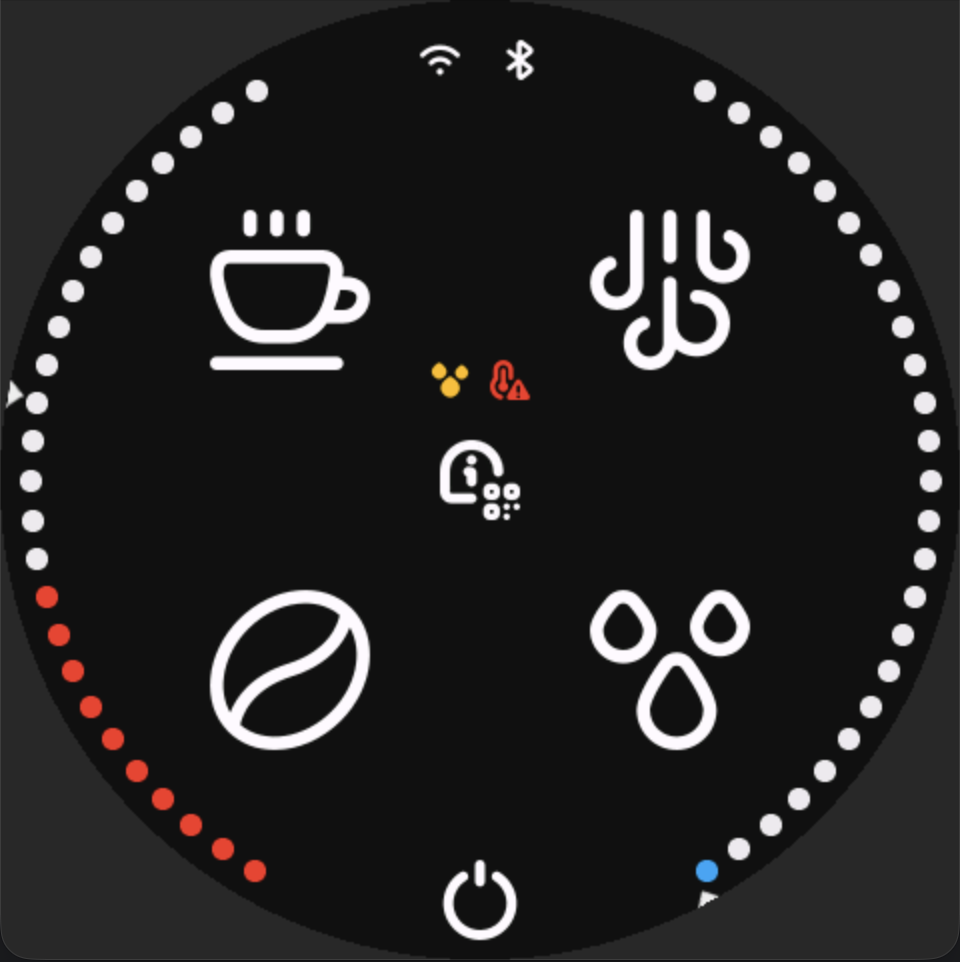
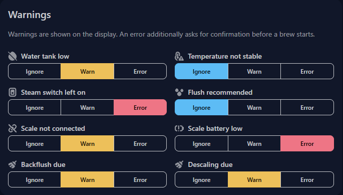

import { Image } from 'astro:assets';
import imgBattery from '../../assets/images/warnings/battery-exclamation-2.svg';
import imgBroom from '../../assets/images/warnings/broom.svg';
import imgHighTemperature from '../../assets/images/warnings/high-temperature-alert.svg';
import imgLightSwitch from '../../assets/images/warnings/light-switch-off.svg';
import imgNoConnection from '../../assets/images/warnings/link-slash-alt.svg';
import imgFlush from '../../assets/images/warnings/raindrops-filled.svg';
import imgNoWater from '../../assets/images/warnings/tint-slash.svg';
import imgSettings from '../../assets/images/warnings/tint-slash.svg';

You installed GaggiMate, and you are about ready to brew, but what is that small icon in the middle of the screen?

### Warnings

First lets show an example of warnings you might seen on screen with your GaggiMate\

On this image we see 2 warnings on the center of the screen.  
The first warning is a yellow droplet, and the second a red temperature warning.
But a icon doesnt say much if you dont know what they mean.

There is currently 8 different warning icons in use. (two the currently share the same icon)
The warnings are the following:

Low battery icon, meaning that the connected scale has a low battery status.

Cleaning/broom icon, this has a double meaning for now, it is both descaling and backflushing. The webinterface can tell you if it is one or the other.

Temperature alert icon. Meaning the temperature has not settled around the target temperature yet.  
Please note that the absence of this warning does not mean that your espresso machine is temperature stable, this just means that the probe is meassuring around the target temperature. Please still preheat your boiler sufficient.

Switch icon, indicating that the steam switch is currently engaged, this could lead to the 3 way valve not opening towards the grouphead if you try to brew.

No connection icon. There is not a scale connected to GaggiMate currently.

Rain drops icon. You need to flush before your next shot. (Not backflush, just regular flush. Psst, did you know if you long-press the play icon on the brew screen, it will flush?) - This warning will appear after just about any other action, as this is a general good idea to do, to ensure the boiler is at its max capacity and there is no debris in the grouphead from previous shots.

Crossed over droplet. Meaning the waterlevel in the tank is currently low.

On the settings page you can set up the alert level you would like for the different warning types.
These alert levels define how you see them on you screen, and if you would like them to be blocking or just a informative warning.

The levels are:  
Ignore: No warning icon is shown for this type of warning. And you will not be stopped if you try to brew while this is active.
Warn: You will get a yellow icon on the brew and menu pages to warn you about this warning type, but it will not block a brew from starting.
Error: You will get a red icon on the brew and menu pages. You will also get a error message if you try to brew with an active error.

The settings can be found on the GaggiMate webinterface, under Settings and then General.

